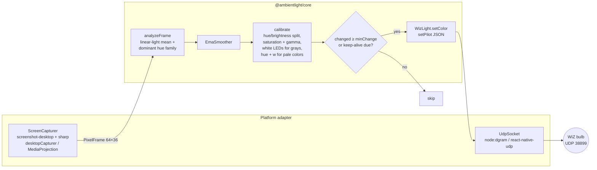

# Architecture

AmbientLight is a TypeScript monorepo. One platform-agnostic **core** holds the WiZ protocol and the whole
color pipeline. Each platform (PC CLI, Electron, React Native) only supplies two small adapters:
a way to **capture the screen** and a way to **send UDP packets**.

## Pipeline

`SyncEngine` drives this loop at the configured FPS (default 10; WiZ bulbs handle about 5–15).

## Packages

### `packages/core` (`@ambientlight/core`)

| Module | Responsibility |
| --- | --- |
| `wiz/constants.ts` | Port 38899, dimming 10–100, broadcast address |
| `wiz/protocol.ts` | `setPilot` / `getPilot` JSON encoding, value sanitizing, reply parsing, `pilotToRestoreParams` |
| `wiz/socket.ts` | `UdpSocket` interface implemented by each platform |
| `wiz/light.ts` | `WizLight`: one bulb. `setColor`/`setPilot` (fire-and-forget), `request` (reply matched by IP + method, one retransmit after 400 ms), `getPilot`, `getSystemConfig`, `getModelConfig`, `setPilotConfirmed`, `turnOff` |
| `wiz/device.ts` | `SystemConfig`/`ModelConfig` types, `bulbKindFromModule` (color, tunable white, dimmable white, plug) |
| `wiz/check.ts` | `checkBulb`: reachability, model, firmware, signed-firmware detection, test color and restore; shared by the CLI and future apps |
| `wiz/discovery.ts` | `discoverBulbs`: broadcast `getPilot`, collect replies |
| `color/average.ts` | `analyzeFrame`: plain mean of a `PixelFrame` in linear light (brightness) plus a vivid-weighted mean of the dominant hue family (hue); `averageColor` returns the plain mean. RGB/RGBA/BGR(A), optional sampling step |
| `color/calibration.ts` | `calibrate`: turns a screen color into WiZ `{r,g,b,c,w,dimming}` (pale colors as hue + white LEDs), or `{temp,dimming}` for near-gray colors; `previewRgb` shows the color a `WizColor` makes |
| `color/smoothing.ts` | `EmaSmoother`, `colorDistance` |
| `sync/engine.ts` | `SyncEngine`: the capture → process → transmit loop |
| `sync/types.ts` | `ScreenCapturer` and `ColorSink` interfaces |
| `platform/timers.ts` | `setTimeout` and the clock without Node.js or DOM typings |

**Rule:** the core must not import `node:*` modules or use Node.js/DOM-only globals. Its `tsconfig.json`
sets `"types": []` so the compiler enforces this. That's what lets the React Native app reuse it.

### `apps/pc-cli` (`@ambientlight/pc-cli`)

| File | Responsibility |
| --- | --- |
| `udp.ts` | `UdpSocket` over `node:dgram` (ephemeral port, optional broadcast) |
| `capture.ts` | `DesktopCapturer`: `screenshot-desktop` JPEG → `sharp` resize to 64×36 raw RGB |
| `network.ts` | Subnet broadcast addresses for every LAN adapter (reliable discovery on Windows) |
| `cli.ts` / `config.ts` | Argument parsing, `ambientlight.config.json` loading and validation, defaults ← file ← flags |
| `commands.ts` | `discover`, `state`, `displays`, `color`, `once` (reads the bulb back after sending), `sync` |
| `check.ts` | `check` (`npm run check-bulb`): runs `checkBulb` on each bulb and prints the report |
| `log.ts` | Live status line with a true-color swatch |

## Design decisions

1. **Average in linear light.** Screens emit light linearly in physical terms. A half-white, half-black
   frame averages to sRGB ≈188, not 128, which matches the room brightness you'd expect.
2. **Split hue from brightness.** WiZ treats `r,g,b` as the color mix and `dimming` as brightness.
   `calibrate` normalizes the color to full value (brightest channel = 255) and maps screen brightness
   onto `minDimming..maxDimming`. A dark red scene therefore gives a dim red, not a muddy brown.
3. **Saturation boost and gamma.** Averaging many pixels washes colors toward gray. Both knobs bring the
   color back. Defaults (1.3 / 1.6) are a starting point for Phase 3 calibration.
4. **Hue from vivid pixels, brightness from the whole screen.** `analyzeFrame` returns two averages. In the
   color one, a pixel counts `1 + colorWeighting × 9 × (saturation × brightness)²` times, so a video in part of
   the screen sets the hue while a small icon on a white page doesn't. `dimming` comes from the plain average.
5. **Dominant color, not a mix of hues.** Averaging different hues gives a color that isn't on screen: red +
   green turns orange, blue + orange turns lavender, many colors turn a pale peach. With `colorMode: "dominant"`
   (the default), `analyzeFrame` sorts colorful pixels (chroma, i.e. max − min channel, ≥ 0.12) into 36 hue bins
   of 10°. Each pixel votes with its chroma, so both area and vividness count. The 50° window with the most votes
   is the dominant hue family; only its pixels and the neutral ones (gray, white, black) are averaged. Close hues
   (red and orange) still blend, and white areas still wash the color out, so a small icon on a white page stays
   white. The previous frame's hue family wins unless another one has 1.3× its votes (`HUE_STICKINESS`), so two
   similar-sized colors don't make the light jump between them. `colorMode: "average"` mixes everything instead.
   Known issue: when the dominant family does change, `EmaSmoother` blends in RGB, so red → green passes through
   a muddy brownish yellow for a few frames (fix planned in [ROADMAP.md](ROADMAP.md), time-based smoothing).
6. **White LEDs for grays.** WiZ bulbs mix RGB white from their red, green and blue LEDs, and it looks
   lavender (a bulb told `rgb(255,254,255)` shows as `#FF00FF` in the WiZ app, which reads only the hue from
   `r,g,b` and the paleness from the white LEDs; see decision 7). Below `whiteSaturation` (0.15,
   after the boost) `calibrate` returns `temp` instead, and `WizLight.setColor` sends `{temp, dimming}`. A color
   must rise 0.05 above the threshold to leave white mode again, so scenes near it don't flicker between modes.
7. **Pale colors as hue + white LEDs.** The WiZ app sends a pale color as the pure hue on `r,g,b` (smallest
   channel 0) plus the white LEDs, and reads saturation back from them. A pale color mixed from the RGB LEDs alone
   looks pink: `rgb(255,188,133)` (a peach) lit the bulb magenta, and the app reported it as `#FF7300`. So
   `calibrate` encodes colors exactly as the app does, fitted to 11 readings of the app's own colors
   ([WIZ_PROTOCOL.md](WIZ_PROTOCOL.md#pale-colors-hue-on-rgb-paleness-on-the-white-leds)): the hue level rises
   with saturation, white stays at `paleWhite` (140) up to saturation 0.5 and then fades out, and the white is
   tinted by the hue (warm for red, cold for blue). `c` and `w` are always sent, 0 for saturated colors, so no
   white lingers from the previous frame. `previewRgb` undoes the encoding for logs. `paleWhite: 0` restores
   the RGB-only mix.
8. **No backlog, newest frame wins.** The loop handles one frame at a time and waits
   `interval − elapsed` between frames. If capture is slow, the frame rate drops gracefully instead of
   queuing stale colors. A bulb that is behind is never flooded.
9. **Change threshold plus keep-alive.** Frames that barely changed aren't sent, which spares the bulb's
   processor. Because UDP can drop packets, the current color is re-sent every `keepAliveMs` anyway.
10. **Restore on exit.** `sync` reads each bulb's state with `getPilot` before starting. When it stops, it
   restores that state (scene, white temperature, or color, plus brightness).
11. **Monorepo wiring.** npm workspaces and TypeScript project references are used. The core's
   `package.json` has a `"development"` export condition that points at `src/index.ts`. Dev scripts run
   `tsx --conditions=development`, so the CLI runs from source without building the core first. The
   normal build (`tsc -b`) uses `dist/`.

## Adding a platform (Phase 4)

1. Implement `UdpSocket` (send, onMessage, close) on top of the platform's UDP API.
2. Implement `ScreenCapturer.capture()` to return a small `PixelFrame`. Downscale natively; set `order: "bgr"`
   if the native buffer is BGRA.
3. Create `WizLight`s and a `SyncEngine` from `@ambientlight/core`, then call `start()` / `stop()`.

- **Electron:** capture with `desktopCapturer` + a hidden `<video>`/canvas in a renderer, or a
  native module. Do UDP in the main process with `node:dgram`, reusing `apps/pc-cli/src/udp.ts`.
- **Android:** a Kotlin foreground service runs `MediaProjection` → `ImageReader`, downscales, and streams
  RGB (or a pre-averaged color) to TypeScript. UDP goes through `react-native-udp`.
