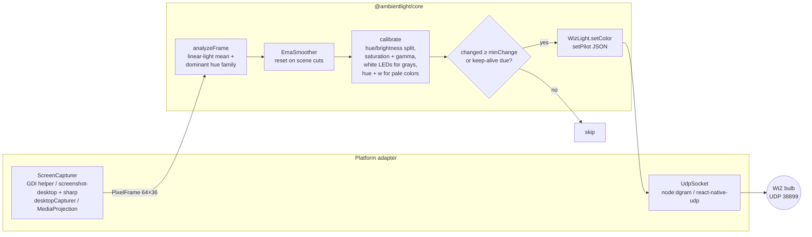
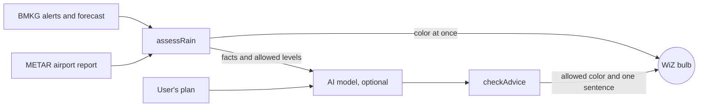

# Architecture

AmbientLight is a TypeScript monorepo. One platform-agnostic **core** holds the WiZ protocol and the whole
color pipeline. Each platform (PC CLI, Electron, React Native) only supplies two small adapters:
a way to **capture the screen** and a way to **send UDP packets**.

## Pipeline

`SyncEngine` drives this loop at the configured FPS (default 20, the rate measured to work on the user's WiZ bulb).

### Latency budget

Measured on the user's PC (Windows 11, one 1920×1080 display at 125 % scaling, 64×36 frames), 2026-11-21:

| Stage | Before | Now |
| --- | --- | --- |
| Capture | 367 ms p50 / 408 ms p95 (`screenshot-desktop`), 685 ms with `screen` set | 32 ms p50 / 35 ms p95 (`"capture": "gdi"`); 260 ms once for the first compile + start |
| Frame rate | ~2.7 FPS at `fps` 10 (capture-bound); 8.8 FPS once capture was fast (timer drift) | 10.0 at `fps` 10; **20.0 at `fps` 20**, now the default (capture 24–41 ms over a ~23-minute run on the real bulb, which kept up) |
| Smoothing | 90 % of a change after ~330 ms (`smoothing` 0.5); only hue jumps > 60° snapped | ~190 ms (`smoothing` 0.7); scene cuts (`sceneCut`) and hue jumps show at once |
| Analysis, `setPilot` send | well under 1 ms | unchanged |
| Wi-Fi + bulb | not measured end to end; `npm run check-bulb` shows the reply time | — |

On average a change on screen waits half a frame interval (25 ms at 20 FPS, 50 ms at 10) before it is captured, plus
the capture itself. `minChange` keeps the bulb from being flooded: in that ~23-minute run, 14 % of the frames
(4,081 of 28,344) were sent. No `setPilot` parameter makes the bulb apply a color faster ([WIZ_PROTOCOL.md](WIZ_PROTOCOL.md#practical-limits)).

## Packages

### `packages/core` (`@ambientlight/core`)

| Module | Responsibility |
| --- | --- |
| `wiz/constants.ts` | Port 38899, dimming 10–100, broadcast address |
| `wiz/protocol.ts` | `setPilot` / `getPilot` JSON encoding, value sanitizing, reply parsing, `pilotToRestoreParams` |
| `wiz/socket.ts` | `UdpSocket` interface implemented by each platform |
| `wiz/light.ts` | `WizLight`: one bulb. `setColor`/`setPilot` (fire-and-forget), `request` (reply matched by IP + method, one retransmit after 400 ms), `getPilot`, `getSystemConfig`, `getModelConfig`, `setPilotConfirmed`, `turnOff` |
| `wiz/device.ts` | `SystemConfig`/`ModelConfig` types, `bulbKindFromModule` (color, tunable white, dimmable white, plug) |
| `wiz/check.ts` | `checkBulb`: reachability, model, firmware, signed-firmware detection, test color and restore; shared by the CLI and future apps |
| `wiz/discovery.ts` | `discoverBulbs`: broadcast `getPilot`, collect replies |
| `color/average.ts` | `analyzeFrame`: plain mean of a `PixelFrame` in linear light (brightness) plus a vivid-weighted mean of the dominant hue family (hue); `averageColor` returns the plain mean. RGB/RGBA/BGR(A), optional sampling step. `frameChange`: mean absolute channel difference of two frames (scene-cut detection) |
| `color/calibration.ts` | `calibrate`: turns a screen color into WiZ `{r,g,b,c,w,dimming}` (pale colors as hue + white LEDs), or `{temp,dimming}` for near-gray colors; `previewRgb` shows the color a `WizColor` makes |
| `color/looks.ts` | `FILM_LOOKS`, `lookForGenres` (genre words → look), `applyLook` (look on top of the user's calibration), `turnHue` (small, bounded hue lean) |
| `color/smoothing.ts` | `EmaSmoother`, `colorDistance` |
| `sync/engine.ts` | `SyncEngine`: the capture → process → transmit loop on fixed frame times; resets the smoothers on scene cuts |
| `sync/types.ts` | `ScreenCapturer` and `ColorSink` interfaces |
| `weather/rain.ts` | `assessRain`: turns a `WeatherSnapshot` (alerts, forecast, airport report) into a `RainLevel` and the facts behind it. No I/O |
| `platform/timers.ts` | `setTimeout` and the clock without Node.js or DOM typings |

**Rule:** the core must not import `node:*` modules or use Node.js/DOM-only globals. Its `tsconfig.json`
sets `"types": []` so the compiler enforces this. That's what lets the React Native app reuse it.

### `apps/pc-cli` (`@ambientlight/pc-cli`)

| File | Responsibility |
| --- | --- |
| `udp.ts` | `UdpSocket` over `node:dgram` (ephemeral port, optional broadcast) |
| `gdi-capture.ts` | `GdiCapturer` (`"capture": "gdi"`, the Windows default): compiles `native/gdi-capture.cs` once into `%LOCALAPPDATA%\AmbientLight\gdi-capture-<hash>.exe`, keeps it running, and reads one 64×36 BGRA frame per request over stdin/stdout. `FrameAssembler` splits the byte stream into frames |
| `native/gdi-capture.cs` | The helper (C# 5, compiled by the `csc.exe` that ships with Windows): per-monitor DPI-aware, `BitBlt` of the display into a bitmap allocated once, `StretchBlt` with `HALFTONE` (area average, measured within 0.5 of the true mean) down to the frame size. Resends the last frame while the secure desktop (UAC, lock screen) blocks capture |
| `capture.ts` | `DesktopCapturer` (`"capture": "screenshot-desktop"`, fallback and macOS/Linux): `screenshot-desktop` JPEG → `sharp` resize to 64×36 raw RGB; `listDisplays` for the `displays` command (its ids work for both backends) |
| `network.ts` | Subnet broadcast addresses for every LAN adapter (reliable discovery on Windows) |
| `cli.ts` / `config.ts` | Argument parsing, `ambientlight.config.json` loading and validation, defaults ← file ← flags |
| `commands.ts` | `discover`, `state`, `displays`, `color`, `once` (reads the bulb back after sending, optionally saves the frame), `sync` |
| `check.ts` | `check` (`npm run check-bulb`): runs `checkBulb` on each bulb and prints the report |
| `frame-file.ts` | `saveFramePng`: writes the analyzed frame as a PNG for `once --save-frame` |
| `film.ts` | `--film`, `--series`, `--look`: one Wikipedia or TVmaze request, exact-title picker, title cache |
| `weather.ts` | `WeatherClient`: fetches and validates BMKG forecast, BMKG CAP alerts (cached per file) and METAR |
| `advisor.ts` | Optional AI advice through Gemini's or Groq's chat-completions endpoint, checked against what the rules allow |
| `rain.ts` | The `rain` command: 2-minute loop, signal colors, simulations, keep-alive, restore on exit |
| `log.ts` | Live status line with a true-color swatch |

## Design decisions

1. **Average in linear light.** Screens emit light linearly in physical terms. A half-white, half-black
   frame averages to sRGB ≈188, not 128, which matches the room brightness you'd expect.
2. **Split hue from brightness.** WiZ treats `r,g,b` as the color mix and `dimming` as brightness.
   `calibrate` normalizes the color to full value (brightest channel = 255) and maps screen brightness
   onto `minDimming..maxDimming`. A dark red scene therefore gives a dim red, not a muddy brown.
   Colors look dim on the bulb, so for them the bottom of that range can rise to `colorBaseBrightness`
   (default 10 = off). Raising `minDimming` instead would also light the room on black and gray screens. The lift
   has two ramps. It fades in over saturation 0.20–0.35 (with the default `whiteSaturation`), so it is zero wherever
   white mode can switch and switching doesn't jump. It also fades in over screen brightness 0.04–0.08 (from
   `blackThreshold`), so black and near-black noise stay dark. The top of the range doesn't move.
3. **Saturation boost and gamma.** Averaging many pixels washes colors toward gray. Both knobs bring the
   color back. Defaults (1.3 / 1.6) are a starting point for Phase 3 calibration.
4. **Hue from vivid pixels, brightness from the whole screen.** `analyzeFrame` returns two averages. In the
   color one, a pixel counts `1 + colorWeighting × 9 × (saturation × brightness)²` times, so a video in part of
   the screen sets the hue while a small icon on a white page doesn't. `dimming` comes from the plain average.
5. **Dominant color, not a mix of hues.** Averaging different hues gives a color that isn't on screen: red +
   green turns orange, blue + orange turns lavender, many colors turn a pale peach. With `colorMode: "dominant"`
   (the default), `analyzeFrame` sorts colorful pixels (chroma, i.e. max − min channel, ≥ 0.12) into 36 hue bins
   of 10°. Each pixel votes with its chroma, so both area and vividness count. The 50° window with the most votes
   is the dominant hue family; only its pixels and the neutral ones (gray, white, black) are averaged. Close hues
   (red and orange) still blend, and white areas still wash the color out, so a small icon on a white page stays
   white. The previous frame's hue family wins unless another one has 1.3× its votes (`HUE_STICKINESS`), so two
   similar-sized colors don't make the light jump between them. `colorMode: "average"` mixes everything instead.
   When the dominant hue does jump more than 60° between frames (`SCENE_CUT_HUE`), `SyncEngine` treats it as a
   scene cut and resets both smoothers, so the new color and brightness show at once. `EmaSmoother` blends in
   RGB, and a fade between hues that far apart passes a muddy color (red → green: olive, shown as brownish
   yellow); up to 60° it stays vivid (red → yellow passes orange). A frame whose pixels changed by `sceneCut`
   (40) or more on average (`frameChange`, 0–255 per channel) is a scene cut too, so hard cuts in brightness
   (a dark scene cutting to a bright one) or within one hue family snap as well (idea from MihirGupta07/wiz-sync,
   which snaps above 40). A red → orange change of the whole screen (43) already counts; motion inside a scene
   stays well below. 40 is a starting point for Phase 3 tuning; `sync -v` marks cut frames.
6. **White LEDs for grays.** WiZ bulbs mix RGB white from their red, green and blue LEDs, and it looks
   lavender (a bulb told `rgb(255,254,255)` shows as `#FF00FF` in the WiZ app, which reads only the hue from
   `r,g,b` and the paleness from the white LEDs; see decision 7). Below `whiteSaturation` (0.15,
   after the boost) `calibrate` returns `temp` instead, and `WizLight.setColor` sends `{temp, dimming}`. A color
   must rise 0.05 above the threshold to leave white mode again, so scenes near it don't flicker between modes.
7. **Pale colors as hue + white LEDs.** The WiZ app sends a pale color as the pure hue on `r,g,b` (smallest
   channel 0) plus the white LEDs, and reads saturation back from them. A pale color mixed from the RGB LEDs alone
   looks pink: `rgb(255,188,133)` (a peach) lit the bulb magenta, and the app reported it as `#FF7300`. So
   `calibrate` encodes colors as the app does (one exception, below), fitted to 11 readings of the app's own colors
   ([WIZ_PROTOCOL.md](WIZ_PROTOCOL.md#pale-colors-hue-on-rgb-paleness-on-the-white-leds)): the hue level rises
   with saturation, white stays at `paleWhite` (140) up to saturation 0.5 and then fades out, and the white is
   tinted by the hue (warm for red, cold for blue). `c` and `w` are always sent, 0 for saturated colors, so no
   white lingers from the previous frame. `previewRgb` undoes the encoding for logs. `paleWhite: 0` restores
   the RGB-only mix.
   **Exception: muted greens** (`mutedGreenCorrection`). The app's tint depends only on the hue, and
   `saturationBoost` plus `gamma` raise the saturation first, so a measured doorway shot (`32,35,25`: saturation
   0.29, about 5400 K, a slightly green white) became saturation 0.52 on 67 % warm white and lit the room yellow.
   For such scenes `calibrate` moves boost and gamma back to 1 and the white to the cold LEDs, which is the light
   the user picked on the bulb. White mode and `dimming` are decided before it, so neither changes. It fades by
   three limits, each there to protect something:

   | Limit | Full effect | No effect | Protects |
   | --- | --- | --- | --- |
   | Hue | 65–150° | below 50°, above 170° | orange, skin, beige, gold; teal and blue |
   | Saturation before the boost | up to 0.35 | from 0.5 | grass, vivid colors |
   | Screen brightness | up to 0.5 | from 0.7 | bright pages (mint, pale yellow), daylight scenes |

   It is a rule on the average color, because the app can't recognize a shot. Matching just that one color failed:
   in 6 of 15 simulated camera moves (crops) the same shot fell out of the range and turned yellow again. The
   saturation fade is 0.15 wide to keep steps at 16 or less (of 255) per 0.01 of saturation.
8. **No backlog, newest frame wins.** The loop handles one frame at a time and sleeps until the next fixed frame
   time (`start + n × interval`). Windows rounds timers up to ~16 ms, so sleeping `interval − elapsed` after each
   frame made every frame late and gave 8.8 instead of 10 FPS; with fixed frame times a late wake-up shortens the
   next wait. If a frame overruns its slot (slow capture), the next one starts at once, without a burst to catch
   up, so the frame rate drops gracefully instead of queuing stale colors. A bulb that is behind is never flooded.
   Smoothing is time-based: `EmaSmoother` scales each step by the time since the previous frame (`smoothing` is
   the share covered per 100 ms), so a slow capture or another `fps` doesn't change how fast the light follows.
9. **Change threshold plus keep-alive.** Frames that barely changed aren't sent, which spares the bulb's
   processor. Because UDP can drop packets, the current color is re-sent every `keepAliveMs` anyway.
10. **Restore on exit.** `sync` reads each bulb's state with `getPilot` before starting. When it stops, it
   restores that state (scene, white temperature, or color, plus brightness).
11. **Monorepo wiring.** npm workspaces and TypeScript project references are used. The core's
   `package.json` has a `"development"` export condition that points at `src/index.ts`. Dev scripts run
   `tsx --conditions=development`, so the CLI runs from source without building the core first. The
   normal build (`tsc -b`) uses `dist/`.
12. **A capture helper that stays running.** Node.js can't call the Windows screen APIs itself; it needs a native
   addon or a helper process. `screenshot-desktop` 1.15 uses a helper process but writes it into a new temp
   folder for every frame. So every frame starts `cmd.exe`, searches for `csc.exe`, compiles the C# helper, starts
   .NET, copies the screen, encodes a full-size JPEG to disk, and Node reads and decodes it (367 ms). The actual
   screen copy is a small part of that. `GdiCapturer` compiles its own helper once (cached by a hash of the
   source, so a source change rebuilds it), starts it once, and asks for frames over a pipe. The helper shrinks
   the frame in GDI, so ~9 KB cross the pipe instead of a JPEG. That leaves the `BitBlt` of the desktop (~30 ms
   at 1080p), which costs the same from C#, C++ or Rust. The helper declares itself per-monitor DPI-aware, so at
   125 % scaling it copies all 1920×1080 physical pixels. node-screenshots (an in-process Rust addon doing the
   same GDI copy) was the alternative. It needs a new native dependency, copies the full 8 MB frame into
   JavaScript, and XCap doesn't set DPI awareness, so it may capture the wrong area at 125 %. If GDI ever isn't
   enough, DXGI Desktop Duplication with a GPU downscale (HyperHDR, Lightpack) is the next step
   ([ROADMAP.md](ROADMAP.md#later-ideas)).
   The helper's byte order was checked on 2026-11-22: a full-screen pure blue window arrived as `[255,0,0,0]`
   (BGRX) and was analyzed as hue 240.
13. **Film looks change the calibration, plus a bounded hue turn.** Settings alone never change the hue, and blending
   in a genre color broke colors (sky → white, hues off by up to 179°). So `applyLook` derives a calibration, and
   `turnHue` runs between smoothing and `calibrate` (scene-cut detection keeps seeing the screen's own hue). The turn
   peaks at 20° for colors 60° from the look's hue and is gone from 120°; with a wider reach a warm look turned teal
   green and the scifi look turned warm scenes red. It fades out on muted greens (decision 7). The color base shrinks
   with a lowered `maxDimming`, or all scenes would get the same brightness.
14. **One request per title, never a guess.** Wikimedia allows 10 requests a minute to clients without contact details,
   and a Wikidata lookup (several requests) hit that limit within seconds. One Wikipedia search returns the first
   sentences of 10 candidates, which name the main genre ("is a 2017 Indonesian supernatural horror film") and other
   names of the film. Only an exact match is accepted, because the top search result for "Wednesday" was "Big
   Wednesday". The lookup happens before the bulb is touched and is cached.

## Rain signal

A prototype of an option that is on hold ([ROADMAP.md](ROADMAP.md#option-rain-signal-on-hold)).

1. **Rules before AI.** The bulb gets the rule color before the AI is called, so a slow or failing model can't delay
   a warning. `checkAdvice` then rejects levels outside `ALLOWED` and invented times.
2. **Never green on missing data.** Any failed or stale source gives `unknown`, except that a known danger still
   shows red. A changed alert format throws instead of reading as "no alerts".
3. **Polygons, not titles.** An alert titled "Jakarta" covered Depok, Bogor and South Tangerang but neither test point in central
   Jakarta, so every alert in the list is read and matched by polygon and time. Files are cached, which keeps the
   requests under BMKG's 60 per minute.
4. **No SDK.** Both AI providers take the same single POST, so `fetch` is enough and the provider follows the key.
   The AI is asked again only when the facts change or the last call failed, to spare free quotas.

## Adding a platform (Phase 4)

1. Implement `UdpSocket` (send, onMessage, close) on top of the platform's UDP API.
2. Implement `ScreenCapturer.capture()` to return a small `PixelFrame`. Downscale natively; set `order: "bgr"`
   if the native buffer is BGRA.
3. Create `WizLight`s and a `SyncEngine` from `@ambientlight/core`, then call `start()` / `stop()`.

- **Electron:** capture with `desktopCapturer` + a hidden `<video>`/canvas in a renderer, or a
  native module. Do UDP in the main process with `node:dgram`, reusing `apps/pc-cli/src/udp.ts`.
- **Android:** a Kotlin foreground service runs `MediaProjection` → `ImageReader`, downscales, and streams
  RGB (or a pre-averaged color) to TypeScript. UDP goes through `react-native-udp`.
